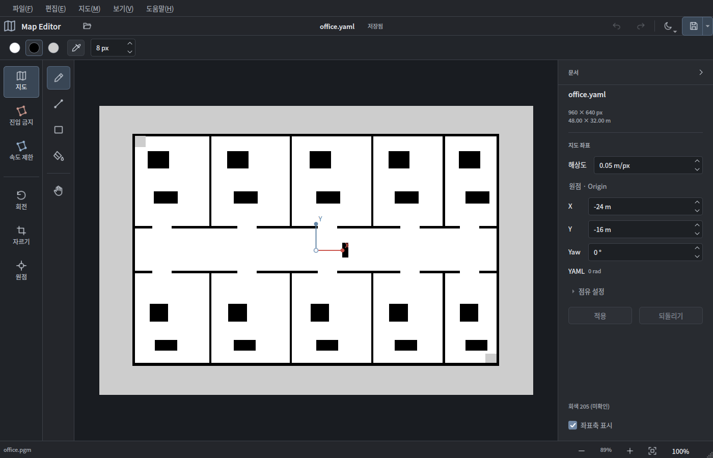

# Map Editor

PGM 지도와 YAML을 함께 편집하고 Nav2 필터 마스크를 만드는 데스크톱 앱입니다.



## 다운로드

[최신 버전 다운로드](https://github.com/YooJuno/map_editor/releases/latest)에서 OS에 맞는 파일을 받아 압축을 풀어 실행하세요. ROS 설치는 필요하지 않습니다.

| OS | 실행 파일 |
| --- | --- |
| Ubuntu 24.04 x64 | `MapEditor.sh` |
| Windows x64 | `bin/mapwright.exe` |
| macOS (Intel / Apple Silicon) | `mapwright.app` |

## 주요 기능

- 흰색·검정·회색 편집과 스포이드
- 드래그로 회전·자르기·원점 조정
- 진입 금지·속도 제한 마스크 생성, 구역별 삭제
- 다크·라이트 테마, 한국어·영어·일본어·중국어 지원

## 사용법

1. YAML 또는 PGM 파일을 열거나 창에 끌어 놓습니다.
2. 왼쪽에서 지도·마스크·좌표 작업을 선택해 편집합니다.
3. `Ctrl/Cmd+S`로 저장하거나 `Ctrl/Cmd+Shift+S`로 새 YAML/PGM 쌍을 만듭니다.

마스크 설정과 단축키는 [사용 가이드](docs/usage.md)를 참고하세요.

## 소스에서 실행

Ubuntu 24.04 기준:

```bash
sudo apt install git build-essential cmake qt6-base-dev libyaml-cpp-dev
git clone https://github.com/YooJuno/map_editor.git
cd map_editor
./run.sh
```

Windows·macOS 빌드와 자동 배포는 [빌드·배포 문서](docs/build.md)를 참고하세요.

[MIT License](LICENSE) · [의존성 라이선스](THIRD_PARTY_NOTICES.md)
