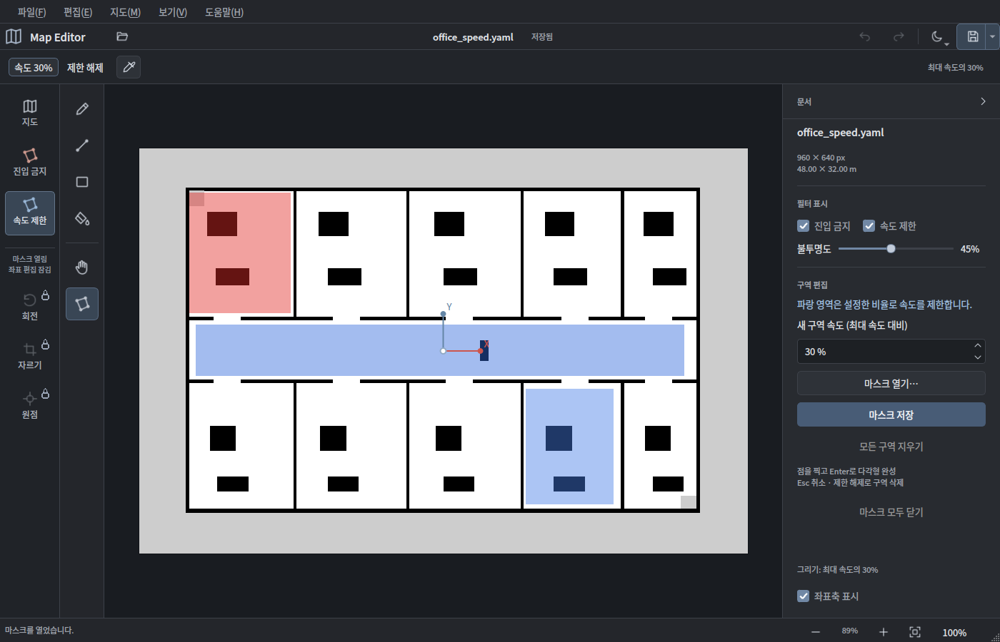
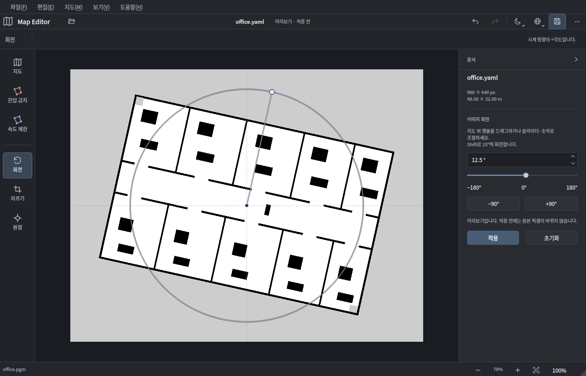
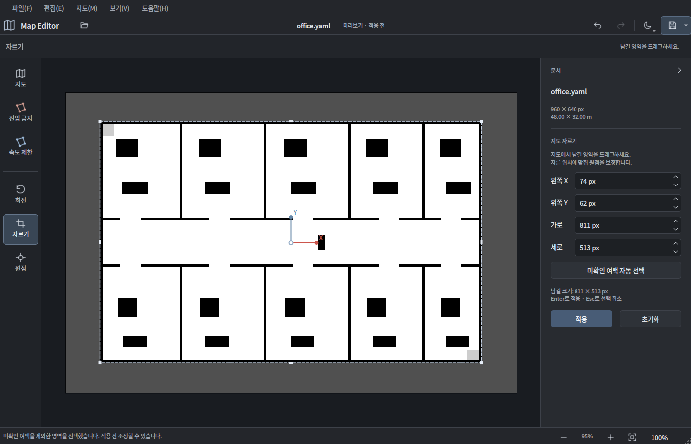
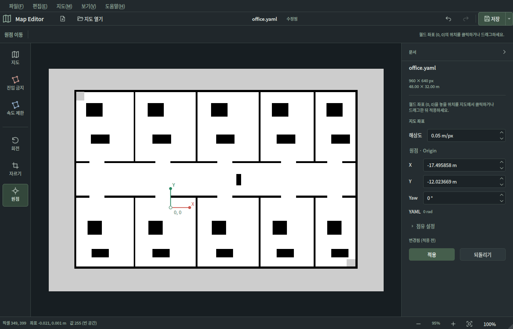

# Map Editor

PGM 이미지와 YAML 메타데이터를 함께 편집하는 Qt 데스크톱 프로그램입니다.
C++17, Qt 6 Widgets, yaml-cpp를 사용합니다. 실행할 때 ROS나 Python은 필요 없습니다.


[라이트 테마 화면 보기](docs/light.png)

## 필터 마스크

원본 지도 위에 반투명 레이어를 겹쳐 Nav2의 진입 금지·속도 제한 마스크를 만듭니다.
원본, 진입 금지, 속도 제한은 각각 별도의 이미지와 실행 취소 기록을 사용합니다.



[다각형 완료 버튼 화면](docs/polygon.png)

1. `지도 열기`로 지도 YAML을 엽니다.
2. 왼쪽 `진입 금지` 또는 `속도 제한` 탭을 고릅니다.
   탭 선택만으로 마스크가 생기지는 않습니다. 실제로 그릴 때 원본과 같은 격자의 마스크를 준비합니다.
3. 사각형을 드래그하거나, 다각형(P)으로 점을 찍고 Enter로 구역을 완성합니다.
   점을 찍으면 상단에 점 개수와 **완료** 버튼이 나타납니다. 원하는 개수만 찍고 완료를
   누르거나 **우클릭**하면 그 점들로 닫습니다. Enter, 첫 점 클릭, 더블클릭도 가능합니다.
   완료 시 마우스가 가리키던 위치는 새 점으로 추가하지 않습니다. Backspace/Ctrl+Z는 찍은 점을
   하나 취소하고, Esc는 현재 다각형을 취소합니다. 상단 `제한 해제`를 선택하면 같은
   펜·사각형·다각형으로 기존 구역의 제한을 지울 수 있습니다.
4. 속도 제한은 그릴 구역의 속도를 1~100%로 정합니다. 30%는 로봇의 최대 속도 대비 30%입니다.
   값을 바꿔도 이미 그린 구역은 그대로입니다. 다른 값으로 겹쳐 그리거나 지워서 수정합니다.
5. 표시 체크박스와 불투명도 슬라이더로 원본과 비교합니다. 화면의 빨강·파랑은 표시용이고
   저장 이미지에는 섞이지 않습니다. 숨기거나 불투명도가 0인 마스크에는 그릴 수 없습니다.
6. `마스크 저장`은 선택한 마스크의 PGM/YAML 쌍만 저장합니다. `파일 → 모두 저장`은
   수정한 모든 레이어를 저장합니다. 다른 레이어 파일에는 덮어쓸 수 없습니다.

기존 마스크는 원본을 연 뒤 해당 레이어의 `마스크 열기`로 불러옵니다. 마스크를 편집하는
동안에는 원본 픽셀이 바뀌지 않습니다. 마스크에 **저장하지 않은 수정 사항**이 있을 때만
원본의 해상도·원점·회전·자르기와 이를 바꾸는 실행 취소/다시 실행을 잠급니다.
저장하면 바로 좌표 작업을 사용할 수 있습니다. 잠금 중 작업 버튼을 누르면 마스크를 저장하고
이어서 작업할 수 있습니다. 취소하면 현재 편집을 유지합니다.
저장한 마스크는 계속 겹쳐 볼 수 있고, 원본 격자나 좌표를 실제로 변경하는 시점에 표시를 닫습니다.
기존 마스크 파일은 보존합니다. 격자가 달라진 원본에는 새 격자에 맞는 마스크를 만들어 주세요.

이 버전은 원본과 **동일한 격자**의 마스크를 지원합니다. 크기·해상도·원점이 다른 마스크는
자동으로 늘이거나 옮기지 않고 오류를 표시합니다. Nav2 Costmap의 회전 원점 제한에 맞춰
마스크 생성은 원본 Yaw가 0인 지도에서 지원합니다.

두 마스크를 겹친 예제도 포함했습니다.

```bash
./run.sh examples/office.yaml --keepout examples/office_keepout.yaml --speed-mask examples/office_speed.yaml
```

### Nav2에서 사용하는 값

마스크는 `mode: raw`, `negate: 0`으로 저장합니다. PGM의 실제 값 0은 제한 없음,
진입 금지는 100, 속도 제한은 1~100(%)입니다. 외부 이미지 뷰어에서는 어둡게 보일 수
있지만 정상입니다. 기존 trinary 마스크는 점유 판정을 유지한 채 읽습니다. 불러온 미확인
셀은 255로 보존하고 회색으로 표시하며, 마우스를 올리면 `미확인`으로 표시합니다.

| 마스크 | CostmapFilterInfo type | base | multiplier |
| --- | --- | --- | --- |
| 진입 금지 | 0 | 0.0 | 1.0 |
| 속도 제한(비율) | 1 | 0.0 | 1.0 |

Nav2에서 각 마스크용 Map Server와 Costmap Filter Info Server를 설정하고, Map Server의
`topic_name`과 Info Server의 `mask_topic`을 동일하게 맞춰야 합니다. 이 에디터는 파일을
만들며 ROS 노드를 실행하거나 로봇 설정을 변경하지 않습니다. 절대 속도(m/s) 인코딩은
현재 지원하지 않습니다.

설정 참고: [진입 금지](https://docs.nav2.org/rolling/tutorials/general_tutorials/navigation2_with_keepout_filter/navigation2_with_keepout_filter/),
[속도 제한](https://docs.nav2.org/rolling/tutorials/general_tutorials/navigation2_with_speed_filter/navigation2_with_speed_filter/).

## 실행

이미 빌드했다면:

```bash
./run.sh
./run.sh examples/office.yaml
```

Ubuntu 24.04에서 처음 빌드하려면:

```bash
sudo apt install build-essential cmake ninja-build qt6-base-dev libyaml-cpp-dev
cmake -S . -B build -G Ninja -DCMAKE_BUILD_TYPE=Release
cmake --build build --parallel
ctest --test-dir build --output-on-failure
./build/mapwright
```

한글 글꼴이 없으면 `fonts-noto-cjk`를 설치하세요. 사용자 경로에 설치된 `ctest`가
동작하지 않는 환경에서는 `/usr/bin/ctest`를 사용할 수 있습니다.

## 사용법

PGM 또는 YAML을 열거나 작업 영역에 끌어 놓습니다. 왼쪽 탭에서 지도·필터·좌표 작업을
선택합니다. 지도와 필터에서는 옆 도구 열에서 그리기 도구를 선택하고, 위쪽 옵션 줄에서
색과 굵기(1~512 px)를 고릅니다. 오른쪽 위 테마 메뉴나 `보기 → 테마`에서 다크·라이트를
선택할 수 있습니다. 기본은 다크이며 선택은 다음 실행에도 유지됩니다.
상단 지구본 아이콘 또는 `보기 → 언어`에서 **한국어, English, 日本語, 简体中文**을 선택합니다.
열린 지도와 편집 중인 내용은 유지한 채 즉시 전환하고, 다음 실행에도 선택을 기억합니다.
메뉴·도구 설명·저장 확인·오류 안내를 번역하며, 운영체제의 파일 선택창은 OS 언어 설정을 따를 수 있습니다.
도구·색·스포이드는 아이콘으로 표시하며, 마우스를 올리면 이름과 단축키를 확인할 수 있습니다.
굵기는 `8 px`처럼 값으로 표시합니다. 기존 PGM·YAML 파일을 열어 편집하는 흐름으로 사용합니다.
사각형은 `내부 채움`을 선택할 수 있습니다. 같은 펜에서 흰색·검정·회색으로 그리거나 지웁니다.
채우기는 같은 픽셀값으로 연결된 영역에 적용합니다.

색 버튼에 마우스를 올리면 실제 저장할 픽셀값과 점유 판정을 확인할 수 있습니다.
기본은 흰색 255, 검정 0, 회색 205이며
회색은 YAML 임계값에서 미확인에 해당하도록 조정됩니다. 원본 회색이 다르면
`I`를 누른 뒤 원본 픽셀을 클릭하세요. 스포이드는 화면 표시색 대신 PGM 값을 가져오고,
선택한 그리기 도구에 값을 적용한 뒤 이전 도구로 돌아갑니다. 스포이드는 색 선택 옆에 있습니다.
회색 옆 `회색 복원`으로 자동값으로
돌아갈 수 있습니다. 원본 픽셀은 열 때 자동 변환하지 않습니다.

오른쪽 속성 패널에서 해상도와 원점을 수정합니다. 각도는 도(°)로 입력하며 YAML에는
라디안으로 저장합니다. `점유 설정`을 펼치면 free/occupied 임계값과 negate를 바꿀 수
있습니다. `적용`으로 반영하고 `되돌리기`로 적용 전 변경을 취소합니다. 저장할 때도
미적용 속성을 반영합니다. 속성 패널을 접었다면 `보기 → 속성 패널`에서 다시 엽니다.
확대·축소, 화면 맞춤과 100% 보기는 오른쪽 아래에 있습니다.
저장 버튼은 선택한 지도나 마스크에 수정 사항이 있을 때 활성화합니다.
저장 버튼 옆 `⋯`에서 `다른 이름으로 저장`과 `모두 저장`을 선택할 수 있습니다.

### 회전·자르기·원점

- **회전(T)**: 왼쪽 회전 탭에서 슬라이더 또는 각도 입력으로 미리 봅니다. ±90° 버튼도
  사용할 수 있습니다. 지도 위 원형 핸들이나 빈 곳을 드래그해 돌릴 수도 있습니다.
  드래그하는 동안 배율과 회전 중심을 고정하며, Shift를 누르면 15° 단위로 맞춥니다.
  Space+드래그와 가운데 버튼은 화면 이동입니다. `적용` 또는 Enter로 반영하며, 초기화·Esc로 취소합니다.
  미리보기는 원본 픽셀을 다시 샘플링하지 않습니다. 적용할 때 원점과 Yaw를 보정해
  월드 위치를 유지합니다. 90° 배수가 아닌 회전은 최근접 보간이므로 얇은 선이 달라질 수 있습니다.
- **자르기(C)**: 남길 영역을 드래그하고, 모서리 또는 네 변의 선분을 잡아 크기를 조절하거나
  안쪽을 끌어 옮깁니다. 변 중앙의 조절점과 가로·세로 커서로 조절 방향을 확인할 수 있습니다.
  X·Y·가로·세로를 숫자로도 조정할 수 있습니다. `미확인 여백 자동 선택`은 빈 공간·장애물을
  포함하는 영역을 선택하며, 적용 전에 수정할 수 있습니다. `적용` 또는 Enter로 잘라냅니다.
  원점을 자동 보정해 남은 픽셀의 월드 좌표를 유지하며 실행 취소로 크기와 원점을 함께 복원합니다.
- **원점(O)**: 월드 좌표 `(0, 0)`을 놓을 위치를 지도에서 클릭하거나 드래그합니다.
  가운데 점을 잡아 옮기거나, X·Y축 끝점을 잡아 현재 원점 주변으로 좌표계를 회전합니다.
  Shift로 15° 단위로 맞출 수 있고, 지도 밖에도 원점을 놓을 수 있습니다.
  오른쪽 X·Y·Yaw가 함께 바뀌며 `적용` 또는 Enter로 반영합니다. 숫자로도 조정할 수 있습니다.
  픽셀은 바꾸지 않고 좌표계를 옮기는 기능입니다. `되돌리기` 또는 Esc로 적용 전 변경을 취소합니다.

Yaw 입력은 좌표계 방향을 바꿉니다. 이미지 회전과 구분해서 사용하세요. 회전 후 빈 모서리와
`지도 → 3색으로 변환`의 회색은 YAML 임계값 기준입니다. 저장 단축키는 진행 중인 회전·자르기
미리보기를 적용한 뒤 저장합니다. 다른 작업 탭으로 이동하면 적용 전 회전·자르기·원점 미리보기는 취소됩니다.

<details>
<summary>회전·자르기·원점 화면 보기</summary>





</details>

## 저장

`저장`은 열린 YAML과 그 파일이 가리키는 PGM을 갱신합니다. `다른 이름으로 저장`은
같은 폴더에 새 이름의 YAML/PGM 쌍을 만들고 `image` 경로도 바꿉니다.
변경 사항이 없는 일반 저장은 파일을 다시 쓰거나 백업을 늘리지 않습니다.

PGM만 열면 기본 해상도 0.05 m/px, 원점 `[0,0,0]`에서 시작하고 저장 시 YAML을 만듭니다.
실제 지도에 맞는 값을 입력하세요. 같은 이름의 YAML이 다른 PGM을 가리키면 오류를 표시합니다.

덮어쓰기 전에는 YAML 폴더의 `.mapwright-backups/`에 원본을 백업합니다.
`original.yaml`, `original.pgm`, 원래 경로를 적은 `paths.txt`가 들어 있습니다.
각 파일은 임시 파일로 작성한 뒤 교체하고, YAML 저장 실패 시 PGM을 복구합니다.
두 파일을 동시에 원자적으로 교체할 수는 없으므로 저장 중 전원 중단 시에는 백업에서
복원해야 합니다. 백업은 자동 삭제하지 않습니다.

실제로 읽어 들인 파일의 SHA-256을 기록해 두며, 그 뒤 파일이 외부에서 바뀌면 일반 저장을 막습니다.
다시 열거나 다른 이름으로 저장하세요. 여러 Map Editor에서 같은 쌍을 동시에 저장하지 못하도록
저장 중에만 파일 옆에 `.mapwright.lock` 잠금을 둡니다. 저장이 끝나면 잠금을 해제합니다.
다른 프로그램과 동시에 같은 쌍을 저장하는 것은 지원하지 않습니다. 심볼릭 링크에는
덮어쓰지 않습니다.

## 단축키

| 동작 | 키 |
| --- | --- |
| 지도 열기 / 저장 | Ctrl/Cmd+O / Ctrl/Cmd+S |
| 다른 이름으로 저장 | Ctrl/Cmd+Shift+S |
| 실행 취소 / 다시 실행 | Ctrl/Cmd+Z / Ctrl/Cmd+Shift+Z |
| 펜 / 직선 / 사각형 / 다각형 | B / L / R / P |
| 채우기 / 이동 / 스포이드 | G / H / I |
| 흰색 / 검정 / 회색 | 1 / 2 / 3 |
| 굵기 줄이기 / 늘리기 | [ / ] |
| 화면 맞춤 / 실제 픽셀 크기 | F / 0 |
| 회전 / 자르기 / 원점 | T / C / O |
| 회전·자르기·원점 적용 | Enter |
| 다각형 완성 | 완료 버튼 / 우클릭 / Enter |
| 회전·좌표축 각도 맞춤 | Shift+드래그 (15°) |
| 이동 | 가운데 버튼 또는 Space+드래그 |
| 진행 중 획 취소 | Esc |

단일 키는 작업 영역에 포커스가 있을 때만 동작합니다. 적용 전 속성 변경이 있는 상태에서
작업 영역의 실행 취소를 누르면 그 변경부터 취소합니다.

## 지원 범위

- Ubuntu, Windows, macOS. Qt 6.4+, CMake 3.21+, C++17 컴파일러가 필요합니다.
- PGM P2/P5, Maxval 255. 저장은 8-bit P5입니다. 다른 Maxval은 정밀도를 조용히
  줄이지 않고 오류를 표시합니다. 최대 32 Mi 픽셀, YAML 최대 1 MiB입니다.
- 원본 지도는 mode 생략 또는 `trinary`를 지원합니다. 필터 마스크는 `raw`와 기존 `trinary`를
  지원합니다. `scale`과 가중치형 keepout 마스크는 지원하지 않습니다.
  임계값은 `0 < free_thresh < occupied_thresh < 1`이고 미확인 회색을 표현할 수 있어야 합니다.
- YAML 추가 키·값과 기존 픽셀값을 보존합니다. 실제 변경을 저장하면 YAML/PGM의
  주석과 서식은 재작성됩니다. 손대지 않은 메타데이터의 숫자 정밀도는 유지합니다.
- 실행 취소는 레이어마다 최대 40회이며 현재 남아 있는 압축 기록이 96 MiB를 넘으면 이전 기록을 비웁니다.
  횟수 제한으로 빠진 기록과 새 편집으로 버린 다시 실행 기록은 메모리 계산에서 제외합니다.

큰 파일 읽기·저장, 채우기, 회전·자르기, 여백 검색, 3색 변환과 편집 기록 압축·복원은
하나의 작업 스레드에서 순서대로 처리합니다. 같은 스레드를 재사용하고 60초 동안 쉬면 해제합니다.
작업 중에도 창 다시 그리기와 화면 이동·확대는 가능하며, 편집·파일 작업과 창 닫기는 완료될 때까지
잠시 제한합니다. 120ms 이상 걸리면 상태 표시줄에 처리 중인 작업을 표시합니다.
편집 상태와 실행 취소 기록 변경은 GUI 스레드에서만 수행합니다.

직선·사각형·다각형의 포인터 이동 미리보기는 최신 입력을 약 16ms 간격으로 반영합니다.
놓기·완료 시 마지막 좌표를 즉시 반영합니다. 그리기 버퍼를 재사용하고 변경한 영역만 복구·비교하며,
레이어·좌표 작업으로 전환하거나 30초 동안 그리지 않으면 임시 버퍼를 해제합니다.
마스크 표시를 꺼도 그리던 다각형이 자동 확정되지
않으며, 상단 완료·취소 또는 Enter·Esc로 마무리할 수 있습니다.
  큰 지도의 채우기·회전은 처리 중 잠시 느려질 수 있습니다.

## Windows / macOS 빌드

Windows는 Visual Studio 2022 C++ 도구, CMake, Git, Qt SDK를 설치한 뒤 x64 개발자
명령 프롬프트에서 빌드합니다(Qt 6.8.3 예시).

```bat
cmake -S . -B build -G Ninja -DCMAKE_BUILD_TYPE=Release -DCMAKE_PREFIX_PATH=C:/Qt/6.8.3/msvc2022_64
cmake --build build --parallel
ctest --test-dir build --output-on-failure
build\mapwright.exe
```

직접 실행 시 Qt `bin`이 PATH에 있어야 합니다. Visual Studio 생성기를 사용한다면
Release 구성을 선택하고 `build\Release\mapwright.exe`를 실행하세요.

macOS는 Xcode Command Line Tools와 Homebrew 환경에서:

```bash
brew install cmake ninja qt yaml-cpp
cmake -S . -B build -G Ninja -DCMAKE_BUILD_TYPE=Release -DCMAKE_PREFIX_PATH="$(brew --prefix qt)"
cmake --build build --parallel
ctest --test-dir build --output-on-failure
open build/mapwright.app
```

yaml-cpp 0.8 이상이 설치되어 있지 않으면 CMake가 고정된 0.8.0 소스를 받아 빌드합니다.
오프라인 빌드는 의존성을 먼저 설치하고 `MAPWRIGHT_FETCH_YAML=OFF`로 설정하세요.

## 실행 패키지

[Releases](https://github.com/YooJuno/map_editor/releases/latest)에서 OS에 맞는 파일을
내려받아 압축을 풀어 사용합니다. Qt 라이브러리와 예제 지도를 포함합니다.
앱 창·작업 표시줄과 Windows 실행 파일·macOS 앱 번들에 전용 아이콘을 포함합니다.
Linux를 CMake로 설치하면 앱 메뉴용 아이콘도 함께 설치합니다.

| 환경 | 배포 파일 | 실행 |
| --- | --- | --- |
| Windows x64 | `MapEditor-버전-windows-x86_64.zip` | `bin/mapwright.exe` |
| Ubuntu 24.04 x64 | `MapEditor-버전-ubuntu-24.04-x86_64.tar.gz` | `./MapEditor.sh` |
| Apple Silicon Mac | `MapEditor-버전-macos-arm64.tar.gz` | `mapwright.app` |
| Intel Mac | `MapEditor-버전-macos-x86_64.tar.gz` | `mapwright.app` |

Linux/macOS의 `.tar.gz`는 실행 권한과 Qt 링크를 보존합니다. `SHA256SUMS`에서 다운로드한
파일의 SHA-256 값을 확인할 수 있습니다. 배포 서명과 macOS notarization은 포함하지 않습니다.

현재는 APT 저장소나 `.deb`를 제공하지 않으므로 `sudo apt install mapwright`로 설치할 수 없습니다.

## 자동 빌드·배포

`main`에 푸시하거나 PR을 열면 네 환경에서 빌드·테스트·패키징합니다.
버전 태그를 푸시하면 모두 성공한 뒤 GitHub Release를 자동으로 게시합니다.
직접 저장하는 토큰 없이 Actions의 `GITHUB_TOKEN`을 사용합니다.

새 버전을 배포할 때는 `CMakeLists.txt`의 `project(... VERSION ...)`을 바꾸고 커밋한 뒤:

```bash
git push origin main
git tag -a v1.2.0 -m "Map Editor 1.2.0"
git push origin v1.2.0
```

태그와 앱 버전이 다르면 배포하지 않습니다. 실패한 실행은 Actions에서 다시 실행할 수 있고,
이미 완성된 Release를 다시 실행하면 기존 배포 파일을 덮어쓰지 않습니다.
태그 없이 실행한 빌드는 [Actions](https://github.com/YooJuno/map_editor/actions)의 아티팩트로
확인할 수 있습니다. Actions에서 직접 실행하려면 `Build, test and release`를 선택하세요.

## 직접 실행 패키지 만들기

직접 Qt 런타임을 묶으려면 Qt 6.7 이상에서:

```bash
cmake -S . -B build -DCMAKE_BUILD_TYPE=Release -DMAPWRIGHT_DEPLOY_RUNTIME=ON
cmake --build build --parallel
cmake --install build --prefix "$PWD/dist"
```

배포 경로는 절대 경로로 지정하세요. Windows 명령 프롬프트에서는 `--prefix "%CD%/dist"`를
사용합니다. Windows/Linux는 `dist/bin/`, macOS는 `dist/mapwright.app`에 실행 파일이
있습니다. Linux는 빌드한 배포판의 glibc와 시스템 GUI 라이브러리 호환성이 필요합니다.

## 소스

`src/mapio.*`는 파일 입출력과 좌표 변환, `src/document.*`는 편집 상태와 실행 취소,
`src/canvas.*`는 그리기와 화면 조작, `src/mainwindow.*`는 UI를 담당합니다.
`src/workqueue.*`는 재사용하는 작업 스레드와 작업 중 조작 제한을 담당합니다.
`tests/`에서 파일 왕복, 백업, 좌표, 마스크, 편집, 비동기 응답과 GUI 회귀를 검증합니다.
`src/i18n.*`와 `resources/i18n.json`에 번역을 내장하므로 별도 번역 패키지나 네트워크가 필요 없습니다.
v1.7.0의 점검 내용과 같은 장비에서 측정한 성능 비교는 [점검 기록](docs/audit-v1.7.0.md)에 있습니다.
`tests/test_i18n.cpp`는 언어 전환 중 편집 상태 보존을, `tests/test_i18n_catalog.py`는 번역 누락과
치환 변수 일치를 검사합니다.

앱 아이콘 원본은 `resources/mapwright.svg`입니다. PNG·ICO·ICNS를 다시 만들려면 개발 환경에
`scripts/icon-requirements.txt`를 설치한 뒤 `python scripts/generate_icons.py`를 실행합니다.
아이콘 생성용 Python 라이브러리는 앱 실행과 일반 빌드에 필요하지 않습니다.
CI는 Windows의 실제 실행 파일 리소스, macOS 번들·ICNS 디코딩, Linux 설치 경로를 확인합니다.

[PGM 규격](https://netpbm.sourceforge.net/doc/pgm.html) ·
[Nav2 map I/O](https://api.nav2.org/nav2-jazzy/html/map__io_8cpp_source.html) ·
[LICENSE](LICENSE) · [의존성 라이선스](THIRD_PARTY_NOTICES.md)
