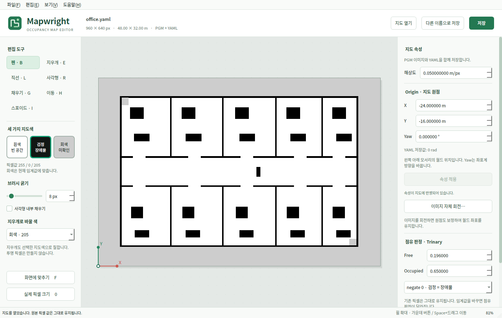

# Mapwright

PGM 이미지와 YAML 메타데이터를 **한 쌍으로 편집·저장**하는 자율주행 지도 에디터입니다.
**C++17 + Qt 6 Widgets + yaml-cpp**로 만들었습니다. 별도 ROS, Python, 웹 브라우저가 필요 없습니다.



## 바로 실행 · Ubuntu 24.04

먼저 저장소를 내려받습니다.

```bash
git clone https://github.com/YooJuno/map_editor.git
cd map_editor
```

아래 직접 빌드 명령을 실행한 뒤에는 다음과 같이 예제 지도를 열 수 있습니다.

```bash
./build/mapwright examples/office.yaml
```

직접 빌드하려면:

```bash
sudo apt update
sudo apt install build-essential cmake ninja-build qt6-base-dev libyaml-cpp-dev
cmake -S . -B build -G Ninja -DCMAKE_BUILD_TYPE=Release
cmake --build build --parallel
ctest --test-dir build --output-on-failure
./build/mapwright
```

`ctest`가 사용자 경로의 잘못된 Python 래퍼를 가리키는 환경에서는 `/usr/bin/ctest`를 사용하세요.
Ubuntu에 한글 글꼴이 없다면 `fonts-noto-cjk`를 설치하세요.

## 편집 기능

* PGM / YAML 열기, 파일 드래그 앤 드롭, 빈 지도 생성.
* 같은 이름의 `.yaml` / `.yml`을 자동 탐색. YAML은 `image`에 지정한 실제 PGM 경로를 사용.
* 펜, 지우개, 직선, 사각형(윤곽 / 내부 채우기), 연속 영역 채우기, 이동.
* 흰색(255), 검정(0), 회색(기본 205)만 브러시에 제공. 굵기 **1~512 px**.
* **스포이드(I)**로 지도 픽셀의 원본값을 추출해 펜과 지우개에 그대로 적용.
* 지우개는 회색 / 흰색 / 검정을 골라 칠하는 방식. 투명 픽셀 없음.
* 휠 확대, 이동, 화면 맞춤, 100%, 고배율 픽셀 격자.
* 픽셀과 월드 좌표, 점유 상태 표시. 원점 및 월드 X/Y 축 표시.
* 이미지 편집, 메타데이터, 이미지 회전 모두 실행 취소 / 다시 실행.
* `resolution`, `origin [x, y, yaw]`, `negate`, 두 점유 임계값 편집.
* 화면 각도는 **도(°)**, YAML 각도는 **라디안(rad)**. 변경한 필드만 갱신하므로
  손대지 않은 고정밀 메타데이터가 화면 표시 자릿수로 반올림되어 저장되지 않음.
* **저장**은 현재 YAML과 그것이 가리키는 PGM을 갱신.
  **다른 이름으로 저장**은 `new_name.yaml` + `new_name.pgm`을 생성하며 YAML `image`도 갱신.

## 사용 순서

1. `지도 열기`로 YAML 또는 PGM을 엽니다. 예제는 `examples/office.yaml`입니다.
2. 왼쪽에서 도구, 지도색, 브러시 굵기를 고르고 수정합니다.
3. 오른쪽에서 원점, 각도, 해상도 등을 바꾼 뒤 `속성 적용`을 누릅니다.
   저장할 때도 미적용 속성을 자동 적용합니다. 변경은 실행 취소할 수 있습니다.
4. `저장` 또는 `다른 이름으로 저장`을 누릅니다.

PGM만 있으면 기본값(`resolution: 0.05`, `origin: [0,0,0]` 등)으로 열고,
저장할 때 YAML을 만듭니다. **실제 지도 해상도·원점을 확인한 뒤 저장하세요.**
같은 이름의 YAML이 다른 PGM을 가리키면 임의로 연결하지 않고 오류를 표시합니다.

## 각도 변경 두 종류

**Origin의 Yaw**를 바꾸면 PGM 픽셀 배열은 그대로 두고 지도 좌표계의 월드 방향을 바꿉니다.
화면의 월드 X/Y 축과 좌표 표시가 갱신됩니다. 예를 들어 90°는 YAML에서
`origin: [x, y, 1.5707963267948966]`가 됩니다.

**이미지 자체 회전**은 시계 방향으로 PGM 픽셀 배열을 회전합니다. 새 바깥 영역은 미확인
회색으로 채우고, 원점과 yaw를 함께 보정하여 회전 전후의 연속 월드 위치를 유지합니다.
90° 배수는 픽셀을 정확히 재배치합니다. 그 외 각도는 최근접 보간을 사용하므로 픽셀
샘플링에 따른 계단 현상이나 얇은 장애물의 손실이 생길 수 있습니다. 저장 전에 화면을
확인하거나 실행 취소하세요. 이미지 모서리가 넓어져 지도 가로·세로가 달라질 수 있습니다.

좌표 계산은 이미지 왼쪽 위가 `(0,0)`, YAML 원점은 왼쪽 아래 **모서리**입니다.
상태 표시줄은 픽셀 중심 위치를 월드 좌표로 표시합니다.

## 세 가지 색과 ROS 점유 판정

기존 PGM의 모든 8-bit 픽셀값은 읽을 때 그대로 유지합니다. **열거나 저장한다는 이유로
전체 이미지를 3색으로 변환하지 않습니다.** 새로 칠하는 픽셀만 선택한 세 가지 색을 씁니다.

기본 `negate: 0`에서는 흰색이 빈 공간, 검정이 장애물입니다. `negate: 1`이면 의미가
반대이며 버튼 설명도 바뀝니다. 회색은 기본 205를 사용하되, 현재 임계값에서 미확인
영역에 해당하지 않으면 두 임계값 사이의 표현 가능한 회색으로 조정합니다.
해당 숫자는 왼쪽에 표시됩니다. 메타데이터 변경만으로 기존 픽셀은 재도색하지 않습니다.

회색이 원본과 달라 보이면 **스포이드(I) → 원본의 회색 영역 클릭**을 사용하세요.
확대된 화면이나 격자·축의 표시색이 아니라 PGM의 실제 픽셀값(예: 204, 206)을 가져옵니다.
샘플값은 임계값으로 자동 보정하지 않고 펜과 지우개에 그대로 적용하며, 이전 편집 도구로
돌아갑니다. 추출만으로는 지도나 YAML이 바뀌지 않습니다. 흰색(255)·검정(0)을 추출하면
해당 기본색을 선택합니다. `회색 자동값으로 복원` 또는 다른 지도 열기로 회색 샘플을
초기화할 수 있습니다. 샘플의 점유 판정은 회색 버튼과 상태 표시줄에서 확인할 수 있습니다.
`전체 지도를 3색으로 정리`와 회전 시 새 모서리의 회색은 YAML 임계값 기준을 사용합니다.

`전체 지도를 3색으로 정리`는 현재 YAML의 점유 판정에 따라 명시적으로 변환합니다.
이 작업은 실행 취소할 수 있습니다. 비교는 ROS trinary 방식의 엄격 부등호
(`p > occupied`, `p < free`)를 사용하며 그 사이가 미확인입니다.

## 저장 및 복구

* 두 파일의 내용을 먼저 임시 파일에 기록합니다.
* 기존 대상이 있으면 YAML 폴더의 `.mapwright-backups/<지도명>-<시각>-<ID>/`에 보관합니다.
  `original.yaml`, `original.pgm`, 원래 경로를 적은 `paths.txt`가 들어 있습니다.
  기존에 없던 파일의 백업은 만들지 않습니다. 백업이 실패하면 원본을 변경하지 않습니다.
* 각 파일은 `QSaveFile`로 교체합니다. YAML 커밋에 실패하면 PGM을 복원합니다.
* **두 파일 전체를 하나의 원자적 트랜잭션으로 교체할 수는 없습니다.** 커밋 사이의
  전원 중단·강제 종료에서는 백업 두 파일을 `paths.txt`에 적힌 위치로 복사해 복구하세요.
  네트워크 파일시스템의 rename/전원 장애 내구성은 해당 파일시스템에 따릅니다.
* 열린 후 다른 프로그램이 원본 파일을 수정·삭제했다면 일반 저장을 막습니다.
  다시 열거나 다른 이름으로 저장하세요. 외부 변경 판정과 실제 저장 사이의 동시 쓰기는
  잠그지 않으므로 동일 파일을 여러 에디터에서 동시에 편집하지 마세요.
* 심볼릭 링크 대상 덮어쓰기는 막습니다. 다른 이름으로 저장을 사용하세요.
* 백업은 자동 삭제하지 않습니다. 필요 없어진 백업은 사용자가 정리할 수 있습니다.

## 지원 범위

* Qt **6.4 이상**, CMake **3.21 이상**, C++17 컴파일러.
* **Ubuntu / Windows / macOS**용 동일 소스와 CI 빌드·패키징 설정 제공.
* 현재 로컬에서 검증한 환경: **Ubuntu 24.04 x86_64 / Qt 6.4.2**.
  Windows / macOS 빌드 작업은 포함했지만 이 환경에서는 실제 실행 검증하지 않았습니다.
* PGM `P2`(텍스트) / `P5`(바이너리), **Maxval 255**. 16-bit 등 다른 Maxval은
  조용히 정밀도를 줄이는 대신 명확히 오류를 표시합니다.
* 저장 형식은 `P5`, Maxval 255. 기존 픽셀 값은 유지되지만 PGM 헤더·주석은 재작성됩니다.
* YAML `trinary` / mode 생략 지원. `scale` / `raw`는 의미가 달라 지원하지 않습니다.
* YAML 추가 키와 값은 유지하며 **주석·서식·앵커 표현은 재작성**됩니다.
* 임계값은 `0 < free_thresh < occupied_thresh < 1`이고 미확인 회색을 표현할 수 있어야 합니다.
* 이미지 최대 **32 Mi 픽셀**, 입력 파일 최대 약 385 MiB, YAML 최대 1 MiB.
* 실행 취소는 최대 **40회**. 압축 기록 누적량이 96 MiB를 넘기기 전 이전 기록을 비웁니다.
  매우 큰 지도·채우기·임의 각도 회전은 UI 스레드에서 처리되어 잠시 반응이 늦어질 수 있습니다.

## Windows 빌드

Visual Studio 2022의 C++ 개발 도구, CMake, Git, Qt 6.8.3 `msvc2022_64`를 설치한 뒤
**x64 Native Tools Command Prompt**에서 실행합니다. yaml-cpp가 없으면 고정된 0.8.0 소스를 받습니다.

```bat
cmake -S . -B build -G Ninja -DCMAKE_BUILD_TYPE=Release -DCMAKE_PREFIX_PATH=C:/Qt/6.8.3/msvc2022_64
cmake --build build --parallel
ctest --test-dir build --output-on-failure
build\mapwright.exe
```

직접 실행할 때는 Qt의 `bin` 폴더를 PATH에 넣거나 아래 런타임 패키징을 먼저 하세요.
Ninja 대신 Visual Studio 생성기를 쓸 경우 빌드 / 테스트 / 설치에 `--config Release` 또는
`-C Release`를 사용하고 `build\Release\mapwright.exe`를 실행합니다.

## macOS 빌드

Xcode Command Line Tools, CMake, Git, Qt 6.4 이상을 설치합니다. 예를 들어 Homebrew 환경에서는:

```bash
brew install cmake ninja qt yaml-cpp
cmake -S . -B build -G Ninja -DCMAKE_BUILD_TYPE=Release -DCMAKE_PREFIX_PATH="$(brew --prefix qt)"
cmake --build build --parallel
ctest --test-dir build --output-on-failure
open build/mapwright.app
```

Intel / Apple Silicon은 해당 아키텍처의 Qt와 컴파일러로 각각 빌드합니다.
이 프로젝트는 범용 universal binary를 자동 생성하지 않습니다.

## 런타임 패키징과 CI

Qt 6.7 이상 SDK에서 아래 명령으로 Qt 공유 라이브러리와 플러그인을 수집합니다.

```bash
cmake -S . -B build -DCMAKE_BUILD_TYPE=Release -DMAPWRIGHT_DEPLOY_RUNTIME=ON
cmake --build build --parallel
cmake --install build --prefix dist
```

Windows: `dist/bin/mapwright.exe`, macOS: `dist/mapwright.app`, Linux: `dist/bin/mapwright`.
Linux 패키지는 빌드한 배포판과 glibc / 시스템 GUI 라이브러리가 호환되어야 합니다.
Qt 6.4 환경에서는 런타임 수집 옵션을 끄고 시스템 Qt 패키지로 실행할 수 있습니다.
설치 대상 컴퓨터에 개발용 SDK가 필요 없는 번들을 만들 수 있지만 Qt 런타임 크기는 포함됩니다.

`.github/workflows/build.yml`은 Ubuntu 24.04 / Windows 2022 / macOS 14에서
빌드·테스트 후 실행 번들을 아티팩트로 올리도록 구성했습니다. 푸시와 PR에서 자동 실행되며,
저장소의 [Actions](https://github.com/YooJuno/map_editor/actions)에서도 직접 실행할 수 있습니다.
배포 서명·macOS notarization·설치 프로그램은 포함하지 않았습니다.

## 단축키

| 동작 | 키 |
| --- | --- |
| 열기 / 저장 / 다른 이름 저장 | Ctrl/Cmd+O / S / Shift+S |
| 실행 취소 / 다시 실행 | Ctrl/Cmd+Z / Shift+Z (Windows Ctrl+Y도 지원) |
| 펜 / 지우개 / 직선 / 사각형 / 채우기 / 이동 | B / E / L / R / G / H |
| 흰색 / 검정 / 회색 | 1 / 2 / 3 |
| 스포이드 · 원본 픽셀값 추출 | I |
| 굵기 줄이기 / 늘리기 | [ / ] |
| 화면 맞춤 / 100% | F / 0 |
| 이동 | 가운데 버튼 또는 Space+드래그 |
| 진행 중 획 취소 | Esc |

단일 키 단축키는 캔버스에 포커스가 있을 때만 동작합니다. 숫자 입력 필드의 입력을 방해하지 않습니다.

## 코드 구조 및 확인한 규격

* `src/mapio.*`: PGM 파싱, YAML, 좌표 변환, 백업 포함 쌍 저장.
* `src/document.*`: 편집 상태, 압축 부분 픽셀 실행 취소, 회전, 외부 변경 감지.
* `src/canvas.*`: 픽셀 도구, 확대/이동, 미리보기.
* `src/mainwindow.*`: 한국어 Qt Widgets UI.
* `tests/test_mapwright.cpp`: PGM 바이트 보존, 오류 입력, YAML 왕복, 백업,
  negate/임계값, 좌표/회전, 실행 취소, 외부 변경, 실제 GUI 편집·저장,
  스포이드 원본값·펜/지우개 적용·초기화 테스트.

규격 참고: [Netpbm PGM](https://netpbm.sourceforge.net/doc/pgm.html),
[Nav2 map I/O 소스](https://api.nav2.org/nav2-jazzy/html/map__io_8cpp_source.html),
[Qt 배포 문서](https://doc.qt.io/qt-6/cmake-deployment.html).

라이선스는 [LICENSE](LICENSE), 의존성 고지는 [THIRD_PARTY_NOTICES.md](THIRD_PARTY_NOTICES.md)를 참고하세요.
